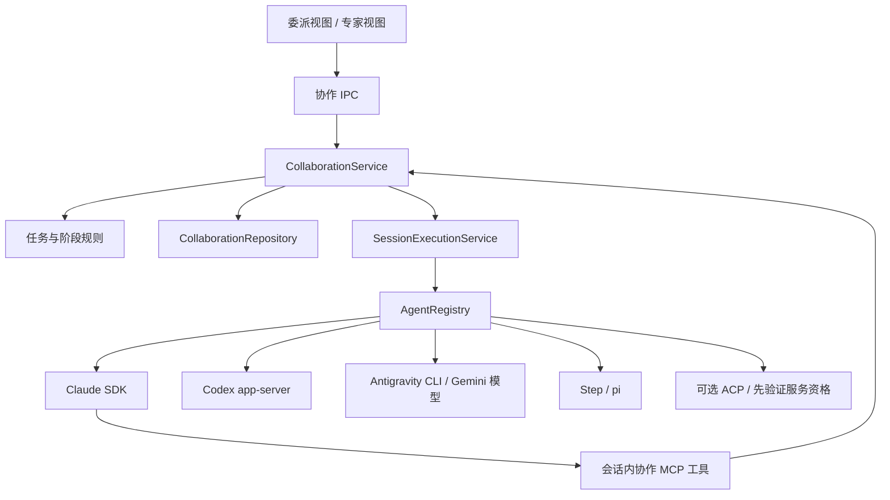

# HCode 多 AI 协作技术方案与实施计划

> 2026-10-12 执行进度：S0/S1 只读闭环、真实阻塞修订与复审、S2 澄清/接管/恢复、S5a 单隔离工作区代码闭环、S1b 当前 Codex 会话委派 Claude，以及 S4 agy/Gemini 只读执行与独立审查已落地。验证范围与限制见 [S2 实施与验收记录](./HCode-多AI协作-S2实施与验收记录.md)、[S5a 实施与验收记录](./HCode-多AI协作-S5a实施与验收记录.md)、[S1b 实施与验收记录](./HCode-多AI协作-S1b实施与验收记录.md)、[S4 实施与验收记录](./HCode-多AI协作-S4实施与验收记录.md)。S3 专家引擎已实现并通过真实原生闭环，桌面续跑验收见 [S3 实施与验收记录](./HCode-多AI协作-S3实施与验收记录.md)。S3b 七类固定组合的角色/Skills 冻结指令加载、领域互审和原会话汇总也已通过真实七人及桌面三方闭环，见 [S3b 实施与验收记录](./HCode-多AI协作-S3b实施与验收记录.md)。S5b 首段预览、冲突检查、安全采纳与显式恢复已通过真实 AI 和桌面采纳验收，见 [S5b 首段记录](./HCode-多AI协作-S5b首段实施与验收记录.md)。S5b 两项独立多写任务的并行、逐任务验证/阻塞修订/复审、采纳冲突与生命周期也已通过真实 Claude/Codex 和桌面验收，见 [S5b 并行记录](./HCode-多AI协作-S5b并行实施与验收记录.md)。最终代码审查、生命周期竞争修复、263 项回归和 0.18.0 安装版真实委派/阻塞修订/复审/逐任务采纳/重启验收已完成，见 [最终审查与安装版记录](./HCode-多AI协作-S5b最终审查与安装版验收记录.md)。后续已同步最新 main 0.19.4，保留响应指标/厂商图标并修复逐任务审查范围与显式续跑问题；281 项回归及安装版并行、Gemini 原文核对、指定复审、采纳与重启通过，见 [最新 main 集成记录](./HCode-最新main集成与安装版验收记录.md)。首版主线闭环已完成；设备/插件工具、Gemini 代码写入及 agy 发起自主委派另行准入。下文为完整设计与切片顺序。

初稿日期：2026-10-10；本次修订：2026-10-12。设计基线：HCode 0.18.0，源码提交 `c474df4`；首轮安装版代码提交 `ea51e33`；后续同步 main `135ae14` 至 0.19.4，最新已验收代码提交 `7eae11f`。状态：首版主线已完成本机安装版验收，已完成范围及后续准入限制以顶部实施记录为准。

**交互改造方案**：已推送的 `main` 为 `6381421`。本轮改造采用“当前输入描述目标 → 当前 AI 提议分工 → 用户调整并明确开始 → 侧面板跟踪任务 → 当前会话汇总”的流程，统一普通对话、协作执行、专家评审和多模型对比入口，角色/Skills、模型及回合预算按需展开。详见 [AI 协作与专家模式交互方案及改造计划](./HCode-AI协作与专家模式交互方案及改造计划.md)。U 系列是新的交互切片，不能与已验收的 S 系列混同；U0–U3 进展见下一条，U4–U6 待实施，正式安装版尚未采用新流程。

**U0 / U1 / U2 / U3 执行更新**：方案提交 `8291b70`，U0 已于 2026-10-13 中文提交为 `9dd441c`。单项只读草案与执行隔离的双向原生验收见 [U0 验收](./HCode-AI协作-U0实施与验收记录.md)。U1 已完成统一工作方式、当前输入复用和持续侧面板；真实开发版只读闭环 4 回合通过，300 项回归通过，见 [U1 验收](./HCode-AI协作-U1实施与验收记录.md)。U1 已于 2026-10-13 中文提交为 `55db781`。U2 的当前 AI 团队推荐、分工编辑、能力确认、独立研究、互审与原会话汇总已完成；四类项目真实推荐、Claude/Codex 两条 6 回合闭环通过，见 [U2 验收](./HCode-AI协作-U2实施与验收记录.md)。U2 已中文提交 `ff0425d`。U3 的单/双任务代码草案、明确范围确认、隔离交付和逐项安全采纳已完成；真实阻塞修订/复审、冲突拒绝和原项目组合复测通过，335 项回归通过，见 [U3 验收](./HCode-AI协作-U3实施与验收记录.md)。U3 尚未提交；本轮没有推送或发布。U4–U6 与正式安装包交互改造仍待继续。

**2026-10-11 接入资格更正**：Google 官方确认自 2026-06-18 起 Gemini CLI 不再向个人免费、Google AI Pro/Ultra 订阅提供请求服务。个人订阅的 Google 模型路径应优先使用现有 Antigravity CLI（agy）Provider；文中 Gemini CLI / ACP 设计保留为符合资格的企业/API 路径研究，不能因本机 gemini 命令存在就标记可用。第 17 节覆盖此前按个人订阅优先接入 Gemini CLI 的建议。

**当前实施基线**：Claude SDK、Codex app-server、Antigravity CLI 原生 Provider 共同承担协作执行。Gemini 模型通过已安装 agy 1.3.3 调用；S4 改为现有 agy 的协作适配。当前会话仍决定发起者，后端能力决定能否自主委派。本文已统一调整核心流程和计划，不再要求个人订阅先接入 Gemini CLI ACP。

**本次交付顺序调整**：首条用户路径收敛为“当前会话委派 → 执行 → HCode 自动送审 → 按意见修订 → 再审查 → 当前会话汇总”。先验证只读报告闭环，再交付单个隔离工作区的代码闭环，之后扩展发起后端、Gemini 与专家互审。首版复用原生 Provider，由 HCode 掌握任务协议、审查状态机和调度；不引入整套外部 Agent 框架。第 11、13.3 节采用同一套依赖与估计。

## 1. 目标与首版范围

在 HCode 现有多 CLI 工作台上增加两种协作模式，共用任务执行、权限、结果、持久化和取消机制。

| 模式 | 用户路径 | 交付结果 |
| --- | --- | --- |
| 协作执行（引擎为主 AI 委派） | 当前会话创建子任务；其他 AI 执行；HCode 自动送审并安排有界修订；当前会话收集交付结果 | 主回答、任务树、版本化产物、审查意见及验证记录 |
| 专家评审（引擎为专家互审） | 用户提出研究问题；专家独立调研；交换报告审查；主持 AI 汇总 | 研究报告、逐项审查、共识、分歧及待验证事项 |

当前会话的 AI就是本次协作的发起者（文中“主 AI”）；不设置固定主 AI品牌，也不要求用户额外选择主 AI。它是否能自主委派由该会话的工具桥接能力决定；另一个 AI是否能被调用由对应 Provider 的任务执行能力决定。工具桥接可以分批实现，但不能据此固定产品中的主从角色。专家是“角色 + AI 引擎 + 模型”的组合，首发保留第 16 节用户指定的七类专家；界面优先显示职责，品牌和模型属于执行配置。角色名称不意味着模型具备专业资质。

首个验证切片支持文本、选定文件引用、只读代码研究、允许范围内的网页研究，并完成报告审查与修订。首个代码交付里程碑增加单个隔离工作区的执行、验证和自动审查；审查通过后展示候选变更，写回原项目另由用户采纳。多写任务并行与采纳放在后续切片，不延后单任务代码闭环。单 AI 会话、现有对比分栏、历史和原生登录保持兼容。

首条真实演示采用“Claude 当前会话委派 Codex，独立 Claude 审查会话检查结果，Codex 修订，原 Claude 会话汇总”。审查角色默认使用发起者的后端/模型配置，但必须具备该阶段的已验证能力，用户启动前可调整；审查使用独立会话，不占用正在等待的原会话。产品规则不绑定品牌，Codex/agy 等发起能力按桥接验收逐项开放。

开发分支产品入口已改为统一“工作方式”：普通对话 / 协作执行 / 专家评审 / 多模型对比。协作和专家复用当前输入，先生成独立计划草案，用户调整并明确开始后才创建 Run；运行、结果和待处理项在会话侧面板持续可见。模型、Skills 和回合预算进入高级设置，实际权限与能力缺口仍在计划中说明。同题对比保留现有并排回答行为，不自动互审。

发起者自动绑定当前会话，新会话与已有会话统一遵循会话能力检查。已有会话缺少工具时，在空闲回合边界验证能否保持原生会话身份恢复并补工具；不支持时明确显示该会话不能启用自主委派，不悄悄换成另一品牌或丢失历史。专家模式仍由当前原会话汇总，阶段调度仍由 HCode 执行。“生成计划”已通过 U0/U1 单项只读验收、U2 专家推荐验收和 U3 代码草案验收，使用独立草案协议及版本确认，不能用立即启动的 `start/startExperts` 代替规划；专家由当前 AI 根据目标和实际资料推荐，用户可调整 2–7 位团队。代码计划由当前 AI 核对实际项目后提议，支持一或两项无依赖、无写入重叠的准确文件范围；宿主发现复制清单与检查，用户保存并明确确认后才创建副本。旧直接启动 API 和历史候选保持兼容。

## 2. 已有基础与真实缺口

| 已有模块 | 可复用能力 | 需要补充 |
| --- | --- | --- |
| `src/main/agents/types.ts`、`registry.ts` | Provider 路由、会话、审批、流式行增量 | 原生回合终态、稳定回合关联、协作能力声明 |
| `agents/claude/claudeSession.ts` | SDK `query()`、异步输入队列、`canUseTool` | 会话内协作工具、协作权限策略、结果归一 |
| `agents/codex/codexSession.ts` | app-server 会话与回合、审批、中断 | 显式映射 completed/failed/interrupted 等真实终态 |
| `src/main/index.ts` 的 `chat:send` | 附件检查、Git 轮次基线、调用 Provider | 提取可复用会话执行入口，供 IPC 与协作同时使用 |
| `src/shared/ipc.ts`、preload | 类型化 IPC 与通道白名单 | 协作命令、快照、增量事件 |
| `renderer/app/conversation/` | 流式时间线、审批和文件预览 | 主子任务导航、专家报告与审查展示 |
| `renderer/app/store/appStore.ts` | 普通会话及 `startCompare` | 独立协作 Store；不要继续堆入原大 Store |

现有 `startCompare` 为同项目创建多个会话，再并行发送相同消息；各 AI 不会自动交换结果。`CompareView` 可以借鉴布局，但不能充当协作调度器。`zcode` 中的 subagent 状态桩也不是已完成的多 AI 编排。

`docs/HCode-功能规划.md` 的 F25 工作目录隔离仍是计划。现有 Git 轮次差异统计无法可靠归属多个 AI 同时在同目录产生的修改。

## 3. 总体架构与职责



三处关键边界：

1. **会话执行**：提取 `chat:send` 中必要的生命周期编排；集中处理附件、工作目录、轮次关联、Git 差异、用量与取消。普通会话和协作调用同一入口，避免协作直接调用 Registry 丢失现有能力。
2. **协作编排**：主进程拥有任务图、阶段、排队、结果回传和恢复；Renderer 只维护展示快照、展开项与输入草稿。界面关闭或切换不会终止任务。
3. **结果契约与交付门槛**：Provider 将原生回合结果映射成机器可读事件；展示用 `ConversationRow` 不作为任务成功的判断依据。TaskResult 是一次执行的结果，Delivery 记录产物版本、审查和验证；原生成功不能直接把交付标为通过。

建议新增位置按实际职责逐步建立：

| 位置 | 职责 |
| --- | --- |
| `src/shared/collaboration.ts` | Run/Task/Result/Delivery/Review/Report 与事件契约 |
| `src/main/collaboration/` | Service、任务规则、交付审查规则、专家阶段规则、报告校验、Repository |
| `src/main/sessions/` | 复用普通聊天生命周期的 SessionExecutionService |
| `src/main/agents/claude/` | SDK 自定义工具桥接，Provider 原生终态转换 |
| `src/main/agents/codex/` | app-server 原生终态转换 |
| `src/renderer/app/collaboration/` | 委派/专家视图、独立 Store、任务卡、证据与审查组件 |
| `src/main/workspaces/`、`src/main/validation/`（S5a 起） | 隔离目录、写入租约、冻结产物与受限验证执行；S5b 再增加采纳 |
| 后续 `agents/acp/` | 按服务资格与协议能力扩展 Agent |

入口文件只注册服务与 IPC。Policy 只处理规则，不读文件、不调用模型；Repository 只持久化，不调度任务。不一次生成整套目录和空壳模块。

## 4. ACP 与 MCP 的使用方式

ACP 解决 HCode 与 Agent 的会话通信，包括初始化、能力协商、提示输入、流式更新、权限请求和取消。多 AI 的任务分派、阶段屏障、互审关系和汇总由 HCode 实现。保留 Claude SDK、Codex app-server 等现有原生通道。

个人 Google AI Pro/Ultra 的 Gemini 模型使用现有 agy Provider：原生 stream-json 会话输出映射到统一回合结果。该路径不走 Gemini CLI ACP；ACP 作为后续符合服务资格的新 Agent 扩展接口。

Claude 主 AI 通过 SDK `createSdkMcpServer` / `tool` 创建进程内工具，并传给当前 `query()` 的 `mcpServers`；不修改用户全局 MCP 配置。当前依赖声明具备这一接口，仍需用实际登录环境验证工具调用与取消。[Claude SDK 官方自定义工具说明](https://code.claude.com/docs/en/agent-sdk/custom-tools)

后续 ACP Provider 在 `session/new` 等受支持的会话入口传 `cwd` 与会话 MCP 配置；先协商能力，再启用对应传输、恢复和关闭功能。不能假定所有 ACP Agent 支持全部能力。[ACP 官方会话协议](https://agentclientprotocol.com/protocol/v1/session-setup)

Codex 发起路径已通过 S1b 的真实闭环验证。2026-10-11 本机 Codex 0.162.0 的实验 `ThreadStartParams.dynamicTools` 可注入工具，服务端 `item/tool/call` 请求由宿主执行并回复。工具目录只在创建线程时注册：新建 Codex 会话需在发送普通消息前启动协作；已有匹配工具的原生线程可恢复，缺少工具的旧线程明确提示原因，不补工具或替换线程。实际验证包含委派 Claude、独立 Codex 阻塞审查、原 Claude 修订、复审、原 Codex 汇总以及 Provider 重建后的同线程续跑。验证失败只影响发起能力，不影响已验证的执行能力；全局 MCP 配置不变。详细边界见第 13 节与 S1b 验收记录。

## 5. 数据与状态契约

### 5.1 核心记录

| 记录 | 必要字段与约束 |
| --- | --- |
| CollaborationRun | id、schemaVersion、mode、logicalProjectPath、initiatorSessionRef、policy、status、stage、revision、createdAt |
| CollaborationTask | id、runId、parentTaskId、role、agent、model、objective、contextRefs、workspaceId、status、attempt、dispatchKey |
| SessionBinding | taskId、sessionKey、nativeSessionId、executionTurnId、nativeTurnId、executionCwd、logicalProjectPath |
| TaskResult | taskId、attempt、outcome、summary、artifactRefs、evidenceRefs、validation、usage、error |
| TaskDelivery | deliveryId、executionTaskId、revision、artifactVersionId、status、reviewPolicy、validationPlanId、revisionCount |
| ArtifactVersion | id、deliveryId、revision、kind、manifestHash、artifactRefs、baselineRef；冻结实际内容，不只记录 Git HEAD |
| ReviewRequest | id、deliveryId、artifactVersionId、reviewerTaskId、round、criteriaVersion、evidenceRefs |
| ReviewResult | reviewRequestId、artifactVersionId、verdict、issueIds、summary；verdict 为 approved / changesRequested / inconclusive |
| ReviewIssue | id、severity、blocking、定位、问题、证据、建议、复现/验证方式、status；关联提出及处理该问题的版本 |
| ValidationRecord | id、artifactVersionId、validationPlanId、runner、commandRef、cwd、outcome、logRefs、startedAt、finishedAt |
| ExpertReport | reportId、taskId、version、summary、claims、evidence、limitations |
| PeerReview | reviewerTaskId、targetReportId/version、items：claimId、verdict、reason、evidenceRefs |
| CollaborationEvent | runId、seq、type、taskId、timestamp、payload |

`logicalProjectPath` 用于侧栏归属，`executionCwd` 用于实际执行；隔离后不能把临时目录当作用户项目。客户端创建的 `executionTurnId` 在发送前建立，避免原生终态比 `send()` 返回更早到达而丢失关联。

回合、执行任务和交付是三层：原生回合成功只说明模型完成了一轮；任务还必须通过结果契约校验；交付还需满足审查与适用的验证门槛。报告声称“测试通过”不等于 HCode 验证过测试。PeerReview 用于专家 claim 互审；ReviewResult 用于委派交付验收，两者共用会话执行、证据和调度机制，保留不同契约。

### 5.2 终态与流转

```text
任务：queued → starting → running ↔ awaitingApproval
                       → succeeded | failed | cancelled | interrupted
任务取消：非终态 → cancelling → cancelled
协作：running ↔ awaitingWorkers / awaitingUser / paused
           → completed | failed | cancelled | interrupted
专家阶段（S3）：expertResearch → peerReview → synthesis
专家回应（后续可选切片）：review → optionalResponse → synthesis
委派交付：executing → validating → reviewing
                              → revising → validating → reviewing
                              → accepted | awaitingUser | failed | cancelled | interrupted
```

只读报告无需运行测试时，ValidationRecord 明确记录 notApplicable 和理由后进入 reviewing；必需验证缺失时进入 awaitingUser，不能把 skipped 当 passed。accepted 表示该版本满足交付门槛；委派 Run 只有在必需交付全部 accepted 且发起会话完成汇总后才 completed。必需交付失败或待处理时保留 failed/awaitingUser 等状态，不能因为主 AI 写了总结就显示成功。代码 accepted 后仍可处于“待用户采纳”。

- `AgentProvider.send()` 返回表示请求已接受，不代表执行完成；`ChatRunState.idle` 也不代表成功。
- 新增 `turnOutcome` 事件，携带 executionTurnId、原生终态、输出/产物引用、错误、用量。Claude 根据 SDK result 子类型及取消记录映射；Codex 根据真实 turn 状态映射；不将缺失状态默认成成功。
- 相同任务 attempt 的终态只落一次；过期回合和重复事件不得覆盖新 attempt。
- 取消与成功竞争以主进程已接受的流转为准；进入 cancelling 后迟到成功仅保留审计，不改成 succeeded。
- 专家报告格式无效时允许一次受预算约束的修正回合；仍无效则失败并保留原文，不能用空报告进入下一阶段。
- 审查请求以 deliveryId + artifactVersionId + round 幂等；重复成功事件不能重复送审。旧版本的审查与验证仅保留历史，不能接受新版本。
- 首次执行 attempt、每次修订 attempt 与审查任务分别关联 native turn；修订不覆盖先前 TaskResult，取消传播到本 Delivery 的所有活动任务。

### 5.3 持久化与恢复

首版采用 `userData/collaborations/<runId>/`：`run.json` 原子快照、`events.jsonl` 有序事件、`artifacts/` 报告与结果。每 Run 串行写入；事件先落盘后发布，快照记录已包含的 seq，启动回放剩余事件。半截尾行只能显式报告并截去不完整尾部，文件中间损坏必须显示恢复失败。

原生对话历史仍由各 CLI 保存，HCode 只保存任务关系、上下文引用、结果与必要报告，不再复制完整工具流。上下文和结果是本机敏感数据，遵循应用目录权限，导出由用户触发。

重启后，未有可信终态的 starting/running/awaitingApproval 标为 interrupted；不自动重跑，不自动重发可能产生副作用的操作。支持用户“重新执行”生成新 attempt。任务已持久化但尚未可靠确认发送的窗口也按 interrupted 处理。

首版不承诺跨进程恢复正在运行的原生 Agent；先保住记录和明确状态。正常退出取消协作会话并释放资源；不为结束一个 Codex 任务杀掉共享 app-server 或其他普通会话。

交付产物清单、审查请求/结果、验证日志和待发送阶段消息同样持久化。阶段先记录待执行意图与幂等键，再派发；重启时不补发无法确认是否执行过的修订/验证。用户重新执行时生成新 attempt，沿用原始基线或明确新建版本，不能悄悄把磁盘现状当成旧版本。

## 6. 主 AI 委派流程

### 6.1 对主 AI 开放的工具

| 工具 | 输入 | 行为 |
| --- | --- | --- |
| `delegate_task` | requestKey、agent、role、objective、contextRefs、scope | 创建执行任务及 Delivery，立即返回 taskId/deliveryId；审查策略继承 Run，不能自行关闭门槛或扩大权限 |
| `get_task_result` | taskId | 返回执行状态、交付阶段、审查、验证、摘要和产物引用；读取不产生新的模型调用 |
| `wait_tasks` | taskIds | 等待本批交付终结或需要用户处理，不以执行回合结束为完成；有界超时返回 pending，由编排层唤醒 |
| `send_task_message` | taskId、requestKey、type、text、contextRefs | 发送 clarification / context / feedback；空闲时追加回合，运行中排队；取消后拒绝追加，不把消息当审批或接受结果 |
| `cancel_task` | taskId、reason | 取消排队或活动任务，释放等待并返回确定状态 |

父 Run、调用者 sessionKey 和权限范围由工具闭包绑定，不接受模型自报身份。工具调用只访问本 Run 内任务；子任务首版没有委派工具，禁止递归派发。

`requestKey` 与 task dispatchKey 用于幂等；发送消息也需要独立幂等键。显式重新执行生成新 attempt，不能误当网络重试去重新执行整个任务。

### 6.2 一次完整委派

1. 用户在当前会话选择“委派”，配置可用执行者、上下文与权限范围，发送目标；发起者就是当前会话的 AI。
2. HCode 建立 Run，绑定当前 sessionKey、原生会话身份与发起回合；检查会话工具桥接能力，在安全回合边界启用协作工具及任务完成规则，不另选主 AI。
3. 主 AI 派发一项或多项任务。例如“Codex 检查登录模块的并发刷新问题，给出源码证据，不修改文件”。
4. 调度器创建独立子会话，通过 SessionExecutionService 执行；任务树展示流式输出和所属审批。
5. 主 AI 用 `wait_tasks` 登记本批等待集合。等待不占用执行者并发槽，防止主 AI 占槽造成死锁。
6. 子任务原生回合终态经过归一和校验后落盘，形成 TaskResult 与冻结的 ArtifactVersion。错误、拒绝、取消同样构成明确回报；执行成功只推进交付阶段。
7. HCode 根据 reviewPolicy 自动建立独立审查任务。只读报告检查证据与需求覆盖；代码交付先运行适用验证，再审查冻结差异、相关源码与验证日志。执行 AI 不需要递归调用另一 AI。
8. approved 且验证门槛满足时接受该版本；changesRequested 返回带证据的阻塞问题，由原执行者在新 attempt 中修订，再冻结新版本、重新验证及送审。inconclusive 不进入自动修订循环，显示缺少上下文/能力并等待用户处理。
9. 等待集合只在各 Delivery accepted/failed/cancelled/interrupted 或 awaitingUser 时释放。工具仍在等待时返回完整交付状态；工具超时且主回合结束时，以持久化 joinId/attempt 投递一次汇总或待处理通知。审查和修订完成前不发送“任务已完成”。
10. 主会话一次只能有一个活动回合；忙碌时消息排队到安全回合边界，新批次建立新等待集合。主 AI 汇总接受产物、失败与缺口；仍有活动交付时主回合结束不能完成整个 Run。未登记等待时，编排层显式提示并按有界规则安排收集回合。

子任务内容作为“待核对的报告数据”回传，附来源与权限范围，不拼成高优先级指令。汇总摘要超限时保留产物引用并显示截断标记，允许主 AI按范围读取完整报告。

### 6.3 审查与修订规则

审查者由启动时冻结的 reviewPolicy 决定；审查会话与执行会话分开，即使使用同一后端也不读取执行者隐藏推理。输入包括目标、范围、项目规范、验收标准、冻结产物及可核对证据。审查者只读，不代替执行者改代码；以实际 modelId 标注模型重复。

- 审查通过须没有未解决的阻塞问题，并满足该任务的必需验证。定位、证据与验收标准缺失的审查意见不能自动转成修复指令；格式不合格可修正一次，仍失败则等待用户。
- 原执行者逐项回应 issueId：已修复并附新证据，或提出异议并附理由。异议由下一次审查核对，不允许执行者自行关闭阻塞问题。
- 默认最多两次修订，最多三次审查（首次 + 两次复审）。轮数、回合数或总时限用尽时进入 awaitingUser，保留最新产物和全部意见；不无限运行“直到通过”。
- 任何受审源码/报告内容变化都会生成新 ArtifactVersion；旧审查和测试结果不可复用为新版本通过。构建输出等非交付文件单列，明确哪些路径参与版本计算，不因排除规则隐藏源码变更。
- 审查失败、权限拒绝或缺上下文不等于执行失败；明确阶段与原因，用户可以补上下文、换审查者、重试或结束。换审查者/验收标准记录 policy revision，新结论不能覆盖旧历史。
- 人工确认“保留有风险产物”记录显式例外和未通过项，不伪造 approved 或测试通过；写回仍通过独立采纳入口。

### 6.4 双向消息与人工接管

执行者可以通过受限工具向发起会话提出上下文问题，并查询回复；工具绑定 runId/taskId，不获得派发、提权或用户审批能力。消息记录 messageId、requestKey、sender、recipient、type、关联交付版本与 replyTo；主进程只在允许的任务图关系中投递，不开放任意会话寻址。首版采用回合边界队列，不承诺各 CLI 都支持运行中插话。

澄清工具按有界时间等待；超时结束该等待并持久化问题。需要回复才能继续的 Delivery 标为 awaitingUser，父会话收到一次待处理通知，不把未完成产物送审。等待发起者/用户回复不占工作者槽；发起者正在 wait_tasks 时返回 needsInput，释放该工具等待，防止双向互等。回复可由发起 AI 在权限范围内提供已有上下文，涉及权限扩大或产品决定时交给用户。

用户“接管”先阻止新阶段派发并请求中断活动协作回合；收到可信终态后标为 paused 并开放人工操作。中断失败时显示 stopping/失败原因，不能显示已暂停。保留会话、工作区和产物；恢复前核对人工改动，变化会使审查/验证失效。用户可补消息、修订范围、重新审查或结束；不因人工接管自动应用代码。

## 7. 专家互审流程

专家模式采用固定阶段编排，主 AI负责主持与解释，不能自由创建无限讨论回合。

专家模式复用委派闭环的会话执行、审查派发、版本证据、消息、预算、持久化和人工接管；S3 已实现“独立调研 → 交叉审查 → 汇总”；可选回应仍为后续切片，不进入当前自动流程。委派模式审查某项交付是否满足验收，专家模式审查 claim 的证据和分歧，不将互审多数票转换成代码交付 accepted。七类组合角色/Skills 沿用第 15–16 节，不在本次重新定义。

| 阶段 | 输入 | 输出与通过条件 |
| --- | --- | --- |
| 独立调研 | 同一问题、同一上下文版本、各自角色与读取范围 | 各自版本化报告；第一阶段不能读取同组其他专家报告 |
| 交叉审查 | 已冻结的调研报告与证据 | 对指定 claim 给出支持 / 反驳 / 证据不足，并说明理由 |
| 可选回应 | 审查意见与原报告 | 原专家给出修订或保留理由；不无限循环 |
| 主持汇总 | 调研、审查、回应、失败信息 | 结论、证据、分歧、局限与需人工决定的问题 |

专家团队从七类组合中按目标、上下文和可核实项目特征推荐，用户可调整 2–7 位。待实施交互不再无条件推荐固定前端/Java/测试团队；无法确定时说明缺口，由用户选择。现有引擎按相关角色安排互审，保留报告版本与 claim 关联；全互审和专家回应仍为后续研究，不属于本轮 U0–U6。

报告格式：每条 claim 有稳定 id、结论、证据引用和局限。源码证据包含相对路径、行号、文件内容 hash；网页证据包含 URL、标题、访问时间与支持该 claim 的摘要。没有访问网页能力的 Agent 必须声明限制，不能凭模型记忆生成“已核实的来源”。

审查记录必须指向 reportId/version/claimId，禁止只写“赞同另一位专家”。报告修订增加 version，并保留被审查的旧版本。UI 可点击一条结论查看证据、审查和修订关系。

最终汇总必须区分：有证据且经审查支持的结论、未解决的分歧、证据不足的推测、未执行验证的建议。多数 AI赞同不等于事实成立。相同后端/模型的不同角色可以运行，但界面必须说明模型重复，不宣称模型来源独立。

阶段屏障等待本阶段所有任务终结；至少两份有效调研报告才能进入互审。失败不悄悄移除专家：用户可重试，或明确选择以部分结果继续。互审缺失或主持失败时展示已有产物与未完成阶段，不标记完整专家流程成功。

## 8. 权限、预算与错误处理

### 8.1 能力与只读边界

Provider 增加协作能力声明：原生终态、可执行的读取/写入限制、网络工具、协作工具注入、结构化结果。按当前后端与版本探测；不把 Agent 名称当作能力保证。

S0–S2 的研究执行与审查任务仅可读取；S5a 的写执行/验证另经过隔离准入，审查任务仍只读。Claude 的只读任务使用明确工具集合与权限策略，拦截写入、删除、Shell、越界路径和未授权 MCP；排除可改变权限的会话动作。项目/用户配置、插件与外部 MCP 的加载也必须纳入协作白名单，不能沿用普通会话的“完全放行”。Codex 验证实际 read-only sandbox 与审批策略后才加入专家列表；不能只靠提示词或 `plan` 标签推断只读。

项目目录限制与只读是两件事；Provider 无法保证所需边界时，使用经验证的运行时隔离或禁用相应协作能力。`cwd`、路径检查和文件 scope 本身不构成 OS 沙箱。网络研究需要会话具有允许的联网工具和域范围；首版不主动开放任意 Shell 来获得网络能力。

模型建议的权限不得高于用户选定的上限；审批只能由用户处理，父 AI不能代替用户批准子 AI工具。审批卡标明 Run、任务、后端、操作与路径。Run 取消后撤销其待审批请求。

### 8.2 建议预设

| 项目 | 首版建议值 | 执行语义 |
| --- | --- | --- |
| 执行者并发 | 2 | 主持等待不占槽；普通聊天有独立协调，不取消普通会话 |
| 委派交付数 | 6 | 指执行者交付数量；系统审查另计回合，不混算为六项用户目标，禁止递归 |
| 委派执行回合总数 | 默认 12 | 含执行、审查、修订、格式修正、澄清续跑与主持汇总；达到上限停止新派发并显示待处理原因 |
| 单项委派修订 | 最多 2 次 | 最多 3 次审查；启动前显示最坏计划回合数，Run 总预算仍优先 |
| 专家数 | S3b 为 2–7；旧三角色记录保持兼容 | 七类预设按需选择；允许重复模型并显示提示 |
| 专家讨论 | 1 轮互审；回应默认关闭 | 开启回应只增加 1 轮，不自动追加 |
| 单个执行回合时限 | 10 分钟 | 墙钟时限包含审批等待，到期取消并告知原因 |
| Run 总时限 | 30 分钟 | 到期停止新派发，取消活动协作回合，保留产物 |
| 等待工具时限 | 30 秒 | 返回 pending，交给持久化等待集合处理 |

这些是产品初始提议，落到独立常量与 Run policy，不写在流程里。用户启动时可在受限范围调整。配额不足不自动切换后端，不自动降低模型质量。

Token/价格预算先做观测与派发前检查；并非所有 Provider 都提供实时 Token 或可靠货币费用，缺失显示未知。真正硬边界是可执行的交付数、任务数、回合数、并发与墙钟时限。单项委派基础为执行 + 审查 + 汇总三回合；两次修订最多另加四回合，发起者规划回合也计入总量。六项目标不能在默认 12 回合预算下承诺全部通过；启动前显示计划与上限，扩大目标后须显式调整预算或缩小范围。S3 限定 2–3 位参与者，共用现有累计 12 回合上限；基础为 1 次当前会话确认 + N 次调研 + N 次互审 + 1 次原会话汇总，即两人 6 回合、三人 8 回合。格式修正最多一次，需为尚未完成的调研、互审及汇总预留预算，重试累计不清零。S3b 已采用独立专家预算，默认 24、硬上限 32；七人基础为 16 回合，重试累计，不自动加额度。显示模型执行回合估计，不宣称等于精确 API 次数。

派发执行任务前预留首次审查与本批汇总的回合预算；不足则明确拒绝新增交付，不先执行后默默跳过审查。修订、格式修正与澄清续跑按剩余预算逐次准入，不能因预留首次审查而保证全部自动修订都能运行。

### 8.3 错误语义

统一错误包含 code、message、taskId、attempt、retryable，保留原生错误摘要。关键 code：AGENT_UNAVAILABLE、CAPABILITY_UNSUPPORTED、PERMISSION_DENIED、TIMEOUT、QUOTA_EXCEEDED、PROCESS_EXIT、RESULT_INVALID、WORKSPACE_CHANGED、PERSISTENCE_FAILED。

持久化失败停止后续派发并明确提示；不要先跑任务再假装保存成功。只对可证明尚未开始执行的临时通信错误做有界重试；执行结果未知时标 interrupted，让用户决定重跑。没有广泛 catch 后返回空结果的成功路径。

## 9. 隔离代码闭环与后续采纳

每个写任务获得独立 Workspace；创建时记录基线、dirty/untracked 文件与来源版本，结果产生 ChangeSet。主 AI可分析候选改动，只有用户采纳动作才能写回原项目。

### 9.1 首个代码交付：单工作区执行、验证、审查、修订（S5a）

先支持一项写任务与一个独立工作区。执行者持有独占写入租约；同一工作区的执行、验证与人工编辑互斥，审查期间冻结受审文件，审查会话仅有只读能力。首版不让多个 AI 同时写同一目录；后续并行使用各自独立目录。修订沿用该工作区与原始基线，新版本保留累计差异，不丢弃此前变更。

ValidationPlan 在启动时从实际项目规范/配置确定，由用户确认可自动执行的检查命令、依赖、路径和权限；例如 HCode 的 typecheck/test/build。ValidationRunner 在受限工作区执行已授权计划，记录命令、退出码、标准输出/错误引用与版本。模型提供的任意 Shell 字符串不能直接变成验证命令；测试/构建脚本同样需满足运行时文件与网络边界。首次目录与依赖准入通过后才开放代码任务。

执行结束后释放写入租约，冻结源码和 ChangeSet，运行验证并检查验证过程是否改变受审文件。若改变则重新冻结，原验证不得绑定到新版本冒充通过；无法稳定取得同一版本证据时等待用户。失败日志回到原执行者并计入修订预算，修订后再验证；必需验证通过才进入接受判定。审查可以给失败版本诊断意见，但不能据此 accepted。缺环境、设备或权限时展示阻塞验证项，研究报告可单独交付，代码交付保持 awaitingUser。

这个切片的最终可见结果为“审查与验证通过的候选变更 + 原会话总结 + 待采纳状态”，原项目保持不变。可人工查看差异、接管修订与取消；S5b 首段已提供用户明确选择版本、冲突检查和安全采纳；未经用户确认的候选仍不能展示为已应用。

### 9.2 依赖与工作区准入

建议首个支持范围为普通 Git 项目：干净项目可选 worktree；脏项目必须明确快照现有改动，不能丢掉用户未提交的上下文。含 ignored 依赖的 Node 项目、CocoaPods/移动项目先验证完整复制或 APFS clone，不能直接套用仅包含 tracked 文件的 worktree。

禁止把可写依赖目录通过符号链接指回原项目；检查外部链接、submodule 和路径逃逸。APFS clone 解决目录复制成本，不解决 Agent 越界权限。

### 9.3 安全采纳与独立多任务并行（S5b）

采纳前对 touched paths 比较基线 hash；目标已变化则停止并展示冲突。首版不自动 merge、提交或推送。逐文件变更包括新增、删除、权限位与二进制，采用计划先验证全体 precondition，再应用，出错需有恢复记录。持久化 apply 状态与恢复日志，避免半途退出留下不可解释修改。

同一原项目采纳串行；“范围外变更”必须阻止采纳并显示。清理只删除已终结且无需保留的 Workspace，保留待采纳结果，不把启动时清理当作无条件删除。

首版支持两项独立任务，用户分别确认目标、Claude/Codex 后端和准确相对文件清单；源 AI 使用确认的 requestKey 派发，宿主不自动启动未派发任务。两份目录在委派前复制共同基线，每项 Delivery 拥有自己的 code、版本、检查、审查、租约和采纳日志；共享 12 回合预算与最多两个执行/审查回合并发。接管、丢弃和续跑按任务执行，单项失败不抹掉其他结果。

逐项采纳不自动合并；同名基线漂移立即阻止后续候选，不同文件逐项采纳后仍需原项目组合复测。同 Run 的采纳、恢复、人工生命周期与续跑操作互斥；存在未完成采纳或待恢复状态时先恢复原项目，再允许 AI 续跑。重启未知停止状态只锁定相关目录，不自动执行。已采纳且无需恢复时用户可显式清理可写副本，冻结历史保留。范围外变更同时在写工具、冻结交付和采纳入口阻止。

## 10. UI 与 IPC

本节交互以 [AI 协作与专家模式交互方案及改造计划](./HCode-AI协作与专家模式交互方案及改造计划.md)为本轮待实施依据：当前输入生成可编辑计划、用户明确开始、运行及结果进入会话侧面板。专家结果优先显示主持建议、共识、分歧与证据；代码通过审查后仍需用户预览、冲突检查和显式采纳。当前安装版使用原多 AI 弹窗，后续渐进迁移并保留历史记录。

委派视图：主对话为中心，侧边任务树展示角色、后端、状态、用量和等待原因；点击任务打开原生时间线；审批仍在对应任务卡；主视图展示可追溯的子任务结果引用。阶段条展示执行、验证、审查、修订轮次与交付；版本页展示差异、阻塞问题、逐项回应和检查日志。明确区分“执行结束”“审查通过”“验证通过”“待用户采纳”“已应用”，不能只显示一个绿色完成标记。

任务卡提供补充上下文、回答澄清、暂停/接管、恢复、重试审查与取消；超限、审查不确定和验证缺失显示原因及可用动作。第一阶段复用任务树与阶段条，任务图拖拽编辑/完整工作流画布不纳入首版。

专家视图：运行时优先显示阶段进度和相关角色，汇总完成后优先显示主持建议、共识、分歧与未验证事项；角色报告和技术明细按需展开。点 claim 查看来源和审查，保留失败角色；报告正文复用现有 Markdown，任务流复用会话卡片。

建议协作 IPC：`collaboration:start/get/list/cancel/retryTask/sendTaskMessage/pause/resume/retryReview`；专家部分增加 `continueWithPartial`；S5a 增加 `previewChanges/discardWorkspace`，S5b 增加 `applyChanges`。查询快照包括 Delivery、ArtifactVersion、Review 和 Validation 摘要，详情按引用读取。命令参数运行时校验，不能只依赖 TypeScript。

主进程推送 `collaboration:event`，携带 runId、单调 seq 与 revision；Renderer 检测跳号后重新取快照，避免漏事件导致假状态。消息正文与文件大内容使用引用按需取，不放进每个事件。preload 通道按项目既有白名单方式扩展。

## 11. 分阶段实施计划

下列 S 系列为首版引擎的原始交付顺序与历史估计，完成情况以顶部验收记录为准。本次新增交互改造按 **U0 草案/原生验证 → U1 只读协作入口 → U2 专家推荐与互审 → U3 代码计划与采纳 → U4 进度/结果导航 → U5 人工处理/恢复 → U6 安装版验收** 执行；每个切片的 AFK/HITL、验收标准和边界见独立交互计划，不重复实现已完成引擎。

工作量按一名熟悉 HCode 的工程师估计，单位为有效开发工作日，含对应测试与一次真实后端验证。不是上线承诺；原生协议与权限验证失败时先调整范围。

| 切片 | 可演示交付 | 估计 | 依赖 |
| --- | --- | --- | --- |
| S0 协作运行时验证 | 一个研究任务有可信终态，越权请求被实际拒绝 | 1–2 日 | 无 |
| S1 委派、审查与报告修订闭环 | Claude→Codex 产出报告→独立 Claude 审查→Codex 修订→原会话汇总 | 4–6 日 | S0 |
| S2 可接管与可恢复协作 | 双向澄清、暂停接管、审批、取消、预算、重启状态可信 | 3–4 日 | S1 |
| S5a 单工作区代码闭环 | 独立目录实现→实际验证→自动审查→修订→展示待采纳候选变更 | 3–5 日 | S2，隔离/验证执行准入 |
| S1b Codex 发起工具桥接 | 当前 Codex 会话委派 Claude，复用同一审查闭环 | 1–2 日 | S1；代码演示另依赖 S5a |
| S4 agy / Gemini 协作适配 | 复用已有 Provider，让 Gemini 模型参与执行、审查与专家研究 | 2–3 日 | S2，认证/权限验证 |
| S3 专家互审引擎 | 独立报告 → 交叉审查 → 有证据的主持汇总，复用协作运行时 | 3–5 日 | S2；三模型来源演示依赖 S4 |
| S3b 七类复合专家与 Skills | 七类固定组合可配置、加载、调研、互审并显示真实依赖 | 4–7 日 | S3，选定后端的 Skill 能力验证 |
| S5b 安全采纳与多任务并行 | 两个独立写任务互不影响，用户预览并安全应用候选变更 | 3–4 日 | S5a，采纳恢复验证 |

编号保留以对应之前的方案，S5 拆成 S5a/S5b 并前移 S5a；表格顺序是推荐交付顺序，不按编号机械执行。主线为 **S0 → S1 → S2 → S5a → S1b → S4 → S3 → S3b → S5b**；S1b 可在 S1 后提前，S5b 可在 S5a 后提前，不改变依赖。

| 里程碑 | 累计范围 | 累计估计 |
| --- | --- | --- |
| 报告协作验证版 | S0 + S1 + S2 | 8–12 日 |
| 首个代码协作交付 | 上述 + S5a；Claude→Codex→独立 Claude 审查，用户可接管 | 11–17 日 |
| 双向发起与 Gemini 执行/审查 | 上述 + S1b + S4 | 14–22 日 |
| 专家互审引擎 | 上述 + S3 | 17–27 日 |
| 用户指定七类专家交付 | 上述 + S3b，包含组合角色与 Skills 的效果验收 | 21–34 日 |
| 安全采纳与多写任务完整范围 | 上述 + S5b | 24–38 日 |

首个推荐发布是单工作区代码闭环，先支持已通过真实验证的一条后端路径。七类专家与 Skills 的 4–7 日已计入对应里程碑，不能将只做三角色引擎称为七类专家完成。估计较旧计划增加了委派自动审查、人工接管、真实验证执行和采纳恢复，具体以切片验收为准。CompileHub 构建/运行/崩溃证据接入、移动项目复杂依赖、agy 自主发起桥接与完整工作流画布另计。

### S0 — 原生结果与只读研究验证

**Type — AFK；真实后端验收 HITL。**

**What to build**：建立最小可见研究任务入口，调用现有 Claude/Codex 会话并展示真实回合 outcome；通过真实工具尝试确认读取可用、写入与越界拒绝。提取所需 SessionExecutionService，不做无关模块重构。

**Acceptance criteria**

- [ ] 成功、失败、取消、进程退出各有确定 outcome 与回合关联；idle 不决定结果。
- [ ] 真实 Claude/Codex 读取已授权文件；写入、Shell 绕过、未授权 MCP 与越界尝试符合声明的策略，原项目 hash 不变。
- [ ] 单任务中断不影响普通会话或共享 app-server。
- [ ] `pnpm typecheck`、`pnpm test` 通过；记录 Provider 版本、权限配置及真实运行结果。

**Boundaries**：Domain 为会话执行与协作准入；入口为研究任务 UI/IPC；主进程拥有 executionTurnId；Provider 拥有原生 IO；不含任务互审、写任务、ACP。

**Blocked by**：无；真实登录及额度由现有用户环境提供，缺失时清楚记录 HITL 缺口。

### S1 — 当前会话委派、自动审查与报告修订

**Type — AFK；真实模型路径验收 HITL。**

**What to build**：当前会话通过工具委派只读研究任务；执行报告冻结后，HCode 自动派发独立审查会话，按具体问题安排有界报告修订，最后回到原会话汇总。复用会话执行，新增 Delivery/Review 契约与任务阶段 UI；首次 Claude→Codex→Claude，但不固定品牌关系。

**Acceptance criteria**

- [ ] 一条真实请求使 Claude 委派 Codex，报告自动交给独立 Claude 会话审查，原会话引用最终 deliveryId/版本/证据。
- [ ] 给定存在可核对遗漏的报告，审查形成带证据的阻塞意见，Codex 逐项修订后再审查；通过版才触发最终汇总。
- [ ] 审查绑定冻结版本，重复事件不重复送审，旧版通过不能接受新版；超限、inconclusive 与格式失败显示待处理原因。
- [ ] 发起者自动绑定当前会话；新建及已有会话显示真实可用能力，启用协作不切换品牌、不丢失历史。
- [ ] 两项交付分别关联执行、审查与结果；重复 dispatchKey 不重复执行；回合规划受 Run 预算约束。
- [ ] 有界等待超时后无高频轮询，等待集合终结后仅投递一次汇总消息。
- [ ] 子任务失败得到明确回报；父 AI不能提权或访问其他 Run。
- [ ] 公开 Service 集成测试覆盖早到终态、重复事件、阻塞问题修订、版本失效与仅一次汇总；`pnpm typecheck`、`pnpm test`、`pnpm build` 通过；记录真实闭环。

**Boundaries**：Domain 为委派交付审查；入口为模式选择、MCP 与协作 IPC；状态在 CollaborationService/Repository；模型 IO在 SessionExecutionService；不含写代码、专家阶段、外部框架及自动采纳。

**Blocked by**：S0。

### S2 — 双向澄清、人工接管、预算与重启恢复

**Type — AFK；真实进程退出和审批路径验收 HITL。**

**What to build**：补完整排队、限额、审批归属、双向消息、暂停接管、取消传播和重启恢复 UI；提供用户重新执行/重新审查入口。首版按回合边界投递，不启用未经验证的实时插话。

**Acceptance criteria**

- [ ] Run 取消终结排队任务、中断活动任务、撤销审批、释放等待；迟到结果不重启父 AI。
- [ ] 执行者请求上下文，父会话忙碌时排队且 needsInput 释放 wait_tasks，回复后受控续跑，无双向等待死锁、串 Run 或重复投递。
- [ ] 接管阻止新派发并确认活动回合停止；中断失败不显示 paused；人工修改后旧审查/验证失效。
- [ ] 并发、任务数、回合数与超时上限生效；未知用量明确显示，额度不足不静默换模型。
- [ ] 重启显示已有产物、审查、验证和 interrupted 状态；未经用户动作不重跑、不补发未知状态的副作用操作。
- [ ] 落盘失败、尾行不完整和事件跳号有明确可观察处理。
- [ ] 重启/取消集成验证及 `pnpm typecheck`、`pnpm test`、`pnpm build` 通过。

**Boundaries**：Domain 为协作生命周期与任务消息；入口为任务操作、受限澄清工具和启动恢复；状态在主进程持久化；IO在 Repository/Provider；不含任意会话互发、子任务递归、跨进程自动续跑和权限代批。

**Blocked by**：S1。

### S1b — Codex 当前会话发起委派并收集审查交付

**Type — AFK；真实工具桥接与恢复验收 HITL。**

**What to build**：按本机 app-server 协议版本注册会话动态工具并处理宿主工具请求；当前 Codex 会话委派 Claude，复用 Delivery/Review 流程，收集接受的报告或明确待处理结果。协议细节见第 13.1 节。

**Acceptance criteria**

- [x] Codex 当前会话实际调用工具派给 Claude，经过独立审查及必要修订后继续原会话汇总；源/目标品牌不影响业务策略。
- [x] 实验能力不支持、已有线程无法补工具、恢复后缺工具时明确显示原因，不切换品牌或丢失历史。已有工具线程恢复通过；旧普通线程不能升级，界面提示已验证。
- [x] 请求按原生 threadId/turnId/callId 路由，工具结果按真实 JSON-RPC 请求回复；重复、取消、跨 Run 与权限拒绝行为明确。
- [x] 协议集成与项目检查通过，真实回合验证有记录；代码委派演示仅在 S5a 通过后执行。证据与尚未覆盖的平台见 S1b 验收记录。

**Boundaries**：Domain 为 Codex 工具传输；入口为初始化、线程动态工具与服务端请求路由；协作状态归原 Service，协议 IO在 Codex Provider；不改全局 MCP，不另建调度器。

**Blocked by**：S1；估计 1–2 日，代码演示另依赖 S5a。

### S3 — 专家独立调研与互审

**Type — AFK；报告可用性与成本预设验收 HITL。**

**What to build**：2–3 位通用专家配置、冻结报告、环形审查分配、阶段屏障、证据查看与当前原会话汇总；显示预期回合数和实际用量。S3 仅开放只读源码研究。

复用 S1/S2 的版本、审查派发、消息与恢复，只新增专家阶段规则和 PeerReview 契约；七类预设的固定组合与 Skills 可用性在 S3b 验收。

**Acceptance criteria**

- [x] 三角色首轮独立产出；第一阶段输入不含其他专家报告。宿主报告目录必须在项目外，并核对实际路径与符号链接。
- [x] 每个有效报告有指定审查任务，意见绑定具体 report version/hash 与 claim；源码引用由宿主核对并保存 hash，证据与冻结报告可打开核对。
- [x] 主持报告同时显示共识、分歧和未验证事项；模型重复和失败专家可见。共识至少引用两位专家且各项互审支持，分歧/证据不足不得被汇总遗漏。
- [x] 少于两份有效报告不进入互审；部分继续由用户决定；格式修正不无限重试。暂停、停止、重启中断与显式续跑沿用累计预算。
- [x] 真实代码静态研究完成 Claude/Codex/Gemini 独立报告、环形互审及原 Codex 汇总；阶段 Service、类型检查与构建通过。
- [ ] 网页问题：当前未开放联网工具，单列联网准入后的验收，不以源码研究替代。

**Boundaries**：Domain 为专家流程；入口为当前会话“多 AI 协作”的专家任务类型；阶段与报告归主进程；工具 IO 沿用现有只读执行边界。当前角色为架构、实现、验证，Claude/Codex 会话可发起汇总，agy 可执行/审查；不含七类角色/Skills、联网、代码写入、全互审或自动回应。源码一致性核对已引用文件，不宣称冻结整个项目。

**Blocked by**：S2；涉及 agy/Gemini 的演示需 S4。七类正式专家由后续 S3b 验收，不阻塞引擎切片，不能以引擎通过替代专家效果验收。

### S4 — Antigravity CLI / Gemini 模型协作适配

**Type — AFK；真实认证、模型与权限验收 HITL。**

**What to build**：复用 `agents/agy/`，以已安装 agy 1.3.3 验证模型列表、stream-json 输入输出、原生回合终态与任务权限；让用户有资格访问的 Gemini 模型执行子任务和专家研究。按实际模型列表选择 modelId，不新增 gemini AgentKind 来绕过已有后端。

**Acceptance criteria**

- [x] agy 1.3.3 检测、当前认证、实时模型列表与真实研究回合通过；模型必须明确选择，不自动替换。
- [x] stream-json 的 init/step_update/result、错误、取消和原生身份归一；实际 Gemini 读取/取消及子进程协议重放通过。缺失用量保留未知。
- [x] Claude/Codex 发起的真实研究链路及桌面 Codex→Gemini→Claude 闭环通过；Gemini 还通过隔离代码候选审查、阻塞修订复审和重建后复审。S3 已复用该能力完成三方专家闭环，七类专家效果另归 S3b，不以本项代替。
- [x] 受限角色和认证 MCP 校验工具/路径范围，不传完全放行；权限拒绝、额度错误、无 result 退出及损坏协议通过重放验证，未实际耗尽额度。
- [ ] agy 发起自主委派的同会话工具桥接与恢复仍需单独切片验证；当前明确禁用发起能力，只开放执行/审查，不切换发起品牌。会话级 MCP 已用于受限执行者，不能据此认定发起者恢复也通过。
- [x] 协议/准入边界测试、真实 smoke 与项目类型/测试/构建检查通过；Claude/Codex 的真实执行、审查和原会话恢复在混合链路中通过。

**Boundaries**：Domain 为现有 agy 协作适配；入口为当前会话任务选择与 Provider 模型配置；协议 IO在 AgyAgent/AgySession；协作状态继续由 Service 拥有；不修改全局 MCP 来凑工具注入，不新增个人 Gemini CLI ACP，不重写现有原生接入。

**Blocked by**：S2；当前账号真实可用、模型与任务策略验证。agy 自主委派若需要额外的隔离配置工作，单列后续切片，不拖延已验证的执行者路径。

### S5a — 单隔离工作区的代码审查与修订闭环

**Type — AFK；依赖复制、验证计划与真实代码闭环验收 HITL。**

**What to build**：以已验证的普通项目为首个范围，创建一个独立工作目录与独占写入租约，执行任务、冻结 ChangeSet、运行用户授权的 ValidationPlan、自动审查、按问题修订并复审；原会话展示最终待采纳变更。提供预览、人工接管与丢弃。

**Acceptance criteria**

- [x] 真实 Claude→Codex 实现→检查→独立 Claude 审查→修订→复验/复审→原会话汇总；阶段与记录在 UI 可见。
- [x] 原项目 hash 不变；同一工作区无并发写入，审查只读，接管等待中断与租约释放。
- [x] dirty/untracked 上下文不丢失；依赖可用且没有写回原目录的链接（内部相对链接与 ignored 依赖已验证）。
- [x] 所选真实检查在隔离目录执行，退出码、日志与产物版本对应；检查失败、改变源码或环境缺失不能显示 accepted（已验收 Node/pnpm test；任意项目 typecheck/build 的适配仍需项目准入验证）。
- [x] 种入可复现缺陷检验闭环；审查定位问题、执行者修复、原始复现与必需检查通过后才能交付；超限保留问题等待用户。
- [x] 临时目录历史归属原项目；重启保留候选变更；明确显示待采纳，无原项目写回/自动提交/推送。
- [x] 工作区/验证/交付 Service 行为验证及 `pnpm typecheck`、`pnpm test`、`pnpm build` 通过；记录真实后端和依赖环境。

实施范围、真实记录和验证缺口见 [S5a 实施与验收记录](./HCode-多AI协作-S5a实施与验收记录.md)。

**Boundaries**：Domain 为隔离执行与交付验证；入口为写任务、ValidationPlan 与阶段 UI；工作区/租约归 Workspace 模块，检查 IO在 ValidationRunner，审查状态归 CollaborationService；不含原项目采纳、多写任务并行和未验证移动项目自动支持。

**Blocked by**：S2；所选隔离策略和真实依赖验证通过。

### S5b — 安全采纳与独立写任务并行

**Type — AFK；采纳恢复与并行真实路径验收 HITL。**

**What to build**：基于 S5a 的候选 ChangeSet，增加用户选择采纳、基线冲突检查、应用恢复日志、丢弃与清理；每项并行写任务使用各自独立目录。

**Acceptance criteria**

- [x] 两个 AI 修改同名文件互不影响；原项目在用户采纳前 hash 不变，范围外变更阻止采纳。
- [x] 用户明确选择最新版本；只开放通过审查与验证的交付采纳，未通过例外本段不开放，不伪造通过。
- [x] 采纳前检测所有 touched paths 的基线变化；冲突停止，新增、删除、二进制与权限位行为明确；改动链接、大小写歧义和文件/目录转换拒绝。
- [x] 应用中断/失败有恢复日志和可核对状态，重启不自动继续写回；同原项目应用串行。真实 SIGKILL 与显式恢复通过。
- [x] 清理保留待采纳/需恢复目录；真实依赖项目与冲突演示、首段真实中断恢复、本段逐任务重启/恢复回归以及项目检查通过；无自动提交/推送。

**Boundaries**：Domain 为变更采纳与独立工作区并行；入口为预览/采纳/丢弃；IO在 Workspace/ChangeSet，协作生命周期继续归主进程；不含共享目录多 AI 并发写入、自动合并提交或发布。

**Blocked by**：S5a；基线比较、应用恢复及所选项目准入验证。

## 12. 验证方式与发布门槛

测试优先经过协作 Service、类型化 IPC 或用户路径，验证最终行为。可替代真实 Provider、网络、文件系统故障与时间；不 mock 掉任务规则、报告校验、状态机和关键编排路径。高风险流转先失败测试再实现。

建议失败样例：原生终态先于 send 返回、父回合先结束、重复回传/送审、旧版审查通过后产物变化、审查格式无效或不确定、修订预算耗尽、必需测试失败/未运行、验证脚本改变源码、澄清双向互等、接管中断失败、取消时迟到成功、权限拒绝、余额耗尽、报告格式错误、阶段某专家退出、写盘失败、重启未知执行状态，以及隔离采纳的基线漂移。

首个代码闭环验收必须演示：正常通过路径；已知缺陷被发现、修订后原始复现消失的路径；超过修订上限由用户接管的路径；产物改变使旧通过记录失效的路径。审查者没有发现植入缺陷时保存失败证据并调整审查输入/准则，不宣称通过闭环质量验收。

每个发布切片必须完成类型检查、行为测试、桌面构建和该切片真实后端路径。UI 实测模式入口、任务导航、流式输出、审批、停止、重启与证据跳转；任务状态不能只在日志里正确。

方案提交时仅完成源码与接口核对，尚未执行新的真实协作路径；后续实际状态见文首实施记录。之前 HCode 基线类型检查与 133 项测试通过不等于协作功能已验证。文档变更不重新消耗模型额度。

启动实现前按全局规范声明业务域、入口、模块、数据来源、状态、错误、验证与不改动范围，并从主干创建 `codex/` 分支。每个切片单独评审；提交、推送与 PR 按用户授权执行。

首版需人工验收的决策集中在：真实后端是否达到声明的只读/范围限制、工作区依赖与受限验证计划是否可用、报告与审查是否能辅助决策、并发与回合成本预设是否合适。自动审查不能保证发现全部缺陷；模型重复、设备验证缺失与未解决问题必须可见。实现可先按本提案推进，未通过这些门槛不发布对应能力。

## 13. 补充：Codex 主 AI 与 Gemini 接入（2026-10-11）

### 13.1 Codex 委派 Claude

执行链路：Codex 当前会话 → 原生动态工具 → CollaborationService → Claude SDK 执行会话 → 冻结 TaskResult/ArtifactVersion → HCode 自动审查与有界修订 → Delivery → 原工具结果或受控后续回合 → Codex 汇总。协作 Service 不关心谁是主 AI；只有工具传输桥接因后端不同。

实现位置与协议：

1. `appServerClient.ts`：按锁定版本验证 `initialize.capabilities.experimentalApi` 协商；不对旧 CLI无条件发送实验字段。
2. `codexSession.ts`：新协作线程的 `thread/start` 传 `dynamicTools`，包含澄清读取/回复、委派、查询、等待及授权文件读取的描述和输入 schema；暂停由用户控制入口发起。普通会话不注入，已有普通线程不能通过 resume 补工具。
3. `codexAgent.ts` 路由服务端请求，`codexSession.ts` 与 `hostedToolCalls.ts` 处理 `item/tool/call`，根据真实 threadId/turnId/callId 绑定对应 Run 的运行时，校验 arguments 并调用同一协作 Service。未知工具、冲突请求和跨作用域调用明确拒绝。
4. 将工具执行结果通过原 JSON-RPC 请求 id 回复，格式为 `success` 和 `contentItems`，文本项 type 为 `inputText`；不能直接回复 Claude SDK 的 MCP content 格式。
5. `toolCatalog.ts` 通过 `thread/read` 定位创建元数据，只读核验原生身份、存储范围及工具名称/描述/schema。真实 Provider 重建后，原 Codex 线程可调用工具汇总，并可继续普通对话；桌面暂停与显式复验/复审也沿用原发起线程。重启不自动派发，缺工具或契约不匹配时明确拒绝，不更换线程。CLI 升级后需重新验证实验协议及元数据格式。

该路径使用 app-server 原生工具，不需要配置全局 MCP。工具契约、任务权限与报告格式和 Claude 主 AI相同；不能让模型自行指定其他 Run 或任意执行命令。

S1b 的依赖、边界与验收统一见第 11 节。它增加 Codex 发起能力，复用既有交付与审查规则，不增加第二套主 AI 产品流程；报告验证先做，代码演示依赖 S5a。

### 13.2 个人订阅的 Gemini 模型调用路径

HCode 已有 Antigravity Provider；个人订阅通过该 Provider 运行 Gemini 模型。模型与后端分开：任务选择 `agent="agy"`，model 使用 Provider 返回、当前账号有权访问的 Gemini modelId。界面同时展示“Antigravity / Gemini 模型”，避免将 CLI、模型和订阅资格混为一谈。

本机 agy 1.3.3 已安装到 `/Users/geraldgan/.local/bin/agy`。S4 已验证当前认证、实时模型列表、stream-json 回合、受限 MCP 读取、取消，以及真实委派/审查/修订闭环；Gemini 研究执行和独立代码审查均可用。模型列表和真实额度分别判断，其他平台/版本不自动准入。个人 Pro/Ultra 的 Gemini CLI 服务资格已停止，不能把本机 gemini 0.36.0 / --acp 参数存在当成这一路可用。[Google 官方资格变更](https://developers.google.com/gemini-code-assist/docs/deprecations/code-assist-individuals)

最小端到端链路：

```text
当前会话调用协作工具
  → CollaborationService 创建目标任务：agent=agy，model=已验证 Gemini modelId
  → SessionExecutionService → AgentRegistry → AgyAgent / AgySession
  → agy 原生 stream-json 子会话，HCode 自有目录的受限角色与认证 MCP
  ← init / step_update / result：身份、流式输出、原生终态归一
  → TaskResult / ReviewResult 校验及持久化；委派交付自动进入审查/有界修订
  → 回到原发起会话的工具结果或受控汇总回合
取消：复用并验证 agy SIGINT 与子进程释放，不影响其他会话
```

先复用现有 agy 历史、会话驱动、行投影、模型与额度逻辑，补任务终态和权限隔离；所选模型来自真实模型列表，不写死 Gemini 型号。即使 agy 也能运行其他厂商模型，报告仍记录 backend、实际 modelId 和来源，不能仅靠后端不同宣称模型不同。

当当前会话就是 agy/Gemini 时，它仍决定发起者品牌；自主委派需另外验收发起工具桥接。S4 已有执行者的会话级受限 MCP，但普通已有 agy 会话的角色/工具附加及保持原生身份恢复未通过验收，因此发起入口禁用，不能创建替代品牌或线程。后续单独验证该配置、结果回传、取消和恢复；不直接写用户全局 MCP。[Antigravity MCP 官方说明](https://www.antigravity.google/docs/mcp/)

隔离、只读、联网和无头审批需要独立验证；`--add-dir` 不是沙箱，CLI 的 MCP 支持也不等于会话工具已接通。专家阶段由 HCode 确定性调度时不要求模型自主派发，但发起会话的汇总能力必须可用。

### 13.2.1 可选：Gemini CLI ACP

只在确认企业/API 认证和成本归属后评估，不属于个人 Pro/Ultra 默认路径。接口仍可采用 initialize → session/new → session/prompt、session/update、权限与取消，按真实能力协商实现；需要独立 ACP Provider 与真实服务验证。暂不删除本机 gemini，不尝试更换订阅认证或付费方式来绕过资格限制。

### 13.3 更新后的推荐顺序

本次统一顺序为：**S0 → S1 → S2 → S5a → S1b → S4（现有 agy）→ S3 → S3b → S5b**。先打通报告审查，再交付单隔离工作区的代码实现/验证/审查闭环；之后扩展 Codex 发起、Gemini 执行/审查和七类专家。S1b 可在 S1 后提前，S5b 可在 S5a 后提前；具体依赖以第 11 节为准。S4 的代码执行若需新工作区权限适配，独立验证后再启用，不能用研究通过替代代码准入。Gemini CLI ACP 不进入个人订阅首版依赖链。

累计估计统一采用第 11 节：首个代码闭环 11–17 日；双向发起与 Gemini 执行/审查 14–22 日；专家引擎 17–27 日；含七类组合角色与 Skills 21–34 日；含安全采纳和多写任务 24–38 日。agy 自主发起、其他后端工具桥接与复杂已有会话兼容另行评估，不因 CLI 已安装而省略认证、终态、权限与版本验证。

## 14. 按能力决定协作角色（2026-10-11 修订）

本节以当前会话为发起者，替代任何固定“默认主 AI品牌”的产品假设。需要独立检查两类能力：

- **调用能力**：当前会话能否调用 HCode 提供的协作工具、收取结果并继续同一会话。
- **被调用能力**：Provider 能否接受子任务，在正确权限与上下文中执行，输出流、返回可信终态并支持取消。

这两类能力不对称。目标 AI不需要认识或直接调用发起 AI：HCode 负责启动它及传递结果，不要求 CLI 互相启动，也不要求统一改为 ACP。

| 后端 | 发起自主委派的接入路径 | 被调度执行的基础 | 当前证据与缺口 |
| --- | --- | --- | --- |
| Claude | SDK 会话内 MCP 工具 | 原生 SDK Provider | 真实发起、执行、审查、修订及原会话恢复通过；已有历史受当前能力检查约束 |
| Codex | app-server dynamicTools / item/tool/call | 原生 app-server Provider | macOS 0.162.0 新协作线程及契约匹配历史线程通过；缺工具旧线程明确拒绝 |
| Antigravity / Gemini 模型 | 发起者同会话工具附加/恢复待验证 | 受限角色、认证 MCP 与 stream-json Provider | macOS agy 1.3.3 认证、真实只读执行、独立研究/代码审查、取消、阻塞修订闭环通过；发起与代码写入禁用 |
| StepCode / pi | 需核对自定义工具/扩展桥接 | 已有 RPC Provider | 现有 HCode 未提供协作工具注册；发起能力未验证，不能先标支持 |
| 可选 Gemini CLI | ACP 会话 MCP 服务 | 需独立 ACP Provider | 先验证企业/API 资格；个人 Pro/Ultra 不走此路径 |

“已有 Provider”只是被调用的基础，不代表协作终态、权限和报告已经通过验收。能力状态使用 supported / unsupported / unverified；实际可用性还受本机会话版本、登录、模型、权限、任务类型与正在运行状态影响。

建议 Provider 暴露能力快照：executeTask、invokeCollaborationTools、attachToolsToExistingSession、resumeWithTools、cancelTask，以及 workspace/network 限制；状态附 reason 与验证版本。不要给每种主从组合写专用分支。一次调用只做“源会话可发起 + 目标 Provider 可执行 + 本任务权限与上下文满足”的准入检查。

UI 在当前会话展示协作可用性和可调用 AI列表；只有源发起、目标执行与所选审查者能力均验证过的路径才标为可用。未知能力显示具体缺口；不支持发起的会话仍可继续普通聊天或作为执行者。自动送审由宿主触发，不要求执行者具有 invokeCollaborationTools；子任务的受限澄清工具与递归委派分别判断。首版不开放递归委派属于 Run policy 限制，与该后端本身是否支持工具无关。

专家模式同样绑定当前会话：HCode 调度其他 AI进行调研和互审，结果回到当前会话汇总。专家阶段可由确定性编排触发，不把主持汇总能力误认为模型自主调用工具能力；界面分别说明可用的专家流程与自主委派能力。

## 15. 用本机 Skills 定义和强化专家

专家预设由职责、选定 Skills、报告要求及所需工具构成；AI 后端与模型是执行时的选择，不与专家种类绑定。相同架构专家预设可由 Claude、Codex 或 Gemini 执行，但实际效果与可用工具需要分别验证。

本机可直接借鉴的预设：

| 专家 | 可选本机 Skill | 强化内容 |
| --- | --- | --- |
| 架构专家 | architecture-deepening | 模块深度、职责边界、耦合、方案取舍和测试边界 |
| 故障诊断专家 | bug-diagnosis | 可复现信号、可证伪假设、验证顺序与根因证据 |
| 质量验证专家 | tdd-quality | 行为测试、失败路径、合理 Mock 边界与验证缺口 |

Skill 提供方法与工作规范，不增加模型知识或自动授予工具能力。本机 bug-diagnosis、tdd-quality 还包含修复、写测试等执行步骤；只读专家阶段采用显式标注的研究/审查任务范围，报告无法执行的步骤与验证缺口。不能为了完成 Skill 指令自行提权、改文件或伪称已运行测试。

### 15.1 用户配置

专家卡展示“名称 / 职责 / AI 与模型 / 组合角色 / Skills / 本阶段工具 / 预期产物”。例如“iOS 专家 · Codex · Swift + 移动端 · apple-design + iOS Skills”。七类内置预设按第 16 节固定组合所有已选定相关角色和 Skills，启动前展示冲突与不满足的工具要求，不把全机无关 Skill 目录一起注入。

本机 Skill 由用户选择来源目录，沿用现有 Claude/Codex 技能发现能力；补充用户选定共享目录后可建立跨后端目录。来源包括用户、项目、插件，按真实路径去重，保留来源和名称冲突，不静默合并同名内容。角色预设可以保存与复用；研究和审查阶段可强调不同职责，但固定组合不能静默少加载，报告契约一致。

### 15.2 加载与后端适配

采用两种执行方式，记录实际使用的方式：

1. **原生 Skill 调用**：后端已发现且支持选定 Skill 时，按原生协议调用。HCode 当前 Codex 已通过 skills/list 发现技能，并能发送 type=skill 的输入项；Claude 有技能发现与 SDK 项目配置加载基础。协作多 Skill 绑定及真实执行仍需新增验证。
2. **任务范围的指令加载**：跨后端无法原生使用选定 Skill 时，在经验证的输入接口提供选定 SKILL.md 内容和职责范围；关联 references/scripts/assets 按需提供明确引用。此方式标为“指令加载”，不宣称等同原生 Skill 或插件运行。

只有 SKILL.md 内容可移植不代表整个技能包可运行：依赖 MCP、插件、特定工具或宿主 API 时逐项检查。不满足则显示缺少能力；用户可以改选 Skill 或接受标注局限的研究任务，不能静默丢掉关键依赖。脚本仍必须经过任务权限与工具入口执行，不因出现在 Skill 中而自动运行。

Task 保存 ExpertProfile 快照与 SkillRef：name、sourcePath、contentHash、加载方式、阶段范围、依赖和已读取资源清单。Run 启动时冻结选定版本，随后本机修改 Skill 不改变已开始的任务。原生加载无法保证内容版本一致时显示该限制，不宣称可重现。

Skill 指令不覆盖应用任务权限、项目规则和专家阶段约束；互审报告作为证据数据输入，不成为新的 Skill。发现 Skill 要求与本阶段冲突时明确呈现冲突，不偷偷删改原 Skill 文件。

### 15.3 实施与验收

将本能力作为 S3 的后续垂直切片 S3b：从当前会话选专家预设与本机 Skill，运行独立研究、互审、汇总，在产物中显示实际使用的 Skill 与版本。用户已指定的首批专家库为 iOS、安卓、前端、Java 服务端、需求调研、UI 设计、测试七类，第 16 节替代本节早期“三类通用专家”的首发范围；通用架构、诊断和测试方法作为配套 Skill。

**Type — AFK；组合职责、依赖与领域报告效果验收 HITL。**

**What to build**：沿用专家引擎建立七类固定组合 ExpertProfile，从本机发现并冻结 RoleRefs/SkillRefs，经原生或指令加载进入独立研究/审查会话，并展示实际依赖、版本与报告。

**Acceptance criteria**

- [x] 七类专家预设可配置 AI 后端，专家种类不依赖品牌；支持本机 Agent 职责配置与 Skill 组合，真实依赖与验证缺口可见。
- [x] 选定 Skill 的方法体现在报告内容中，报告有证据与阶段范围；显示注入记录并不等于验证 Skill 已有效遵循。
- [x] 原生调用与指令加载分别可见；关联资源缺失、路径不可读、依赖不满足与同名冲突有明确结果。
- [x] 不修改本机 Skill、不修改全局启用状态；只读专家不会执行写入步骤。
- [x] 对同一问题比较未加 Skill 与加 Skill 的报告，用预设验收标准检查方法、证据与遗漏，不仅检查文字是否包含 Skill 名。
- [x] 第 16 节指定的七类组合逐项核对；每类至少一个真实领域问题产生可核查结果，缺工具明确标注；配置/加载行为验证与 `pnpm typecheck`、`pnpm test`、`pnpm build` 通过。

**Boundaries**：Domain 为专家配置与任务包；入口为固定专家预设、本机目录发现及组合详情；ExpertProfile 由主进程持久化，文件发现/解析沿用并扩展 Extensions 边界；不把 IO 堆进 CollaborationService，不修改本机角色/Skills，不新增未授权插件工具。

**Blocked by**：S3 与相应后端的 Skill/输入能力验证。绑定机制 2–3 日，加七类角色适配与效果验证 2–4 日，合计 4–7 日，已纳入第 11 节里程碑；复杂插件/MCP 技能另计。

S3b 验收通过的范围为只读指令导入与静态领域研究；七人真实闭环 19/24 回合、桌面三方 9/24 回合。基线比较是定性观察，未隔离人数/角色/模型因素，不能宣称 Skill 的独立因果增益。专项工具、设备和真实业务验收仍为 HITL，详情见 [S3b 验收记录](./HCode-多AI协作-S3b实施与验收记录.md)。

## 16. 用户指定的七类专家库

七类预设为 iOS、安卓、前端、Java 服务端、需求调研、UI 设计、测试。专家类型确定职责，Skill 确定方法，AI 后端承担执行；当前会话继续作为发起者和汇总者。专家库不等于每次任务必须同时启动七个会话。

### 16.1 领域职责、报告与审查标准

| 专家 | 调研与建议职责 | 必须交付的领域结果 | 互审时重点检查 |
| --- | --- | --- | --- |
| iOS | 根据项目实际 Swift/Objective-C、SwiftUI/UIKit、系统版本和依赖分析客户端方案、生命周期、并发、权限、性能与设备验证 | 代码入口、状态流、系统兼容限制、实现建议及模拟器/真机验证计划 | 服务契约能否落实；主线程/生命周期/权限风险；交互是否符合目标 iOS 版本；真机证据缺口 |
| 安卓 | 根据实际 Kotlin/Java、Compose/View、SDK 与 Gradle 环境分析生命周期、异步、权限、存储、设备差异与构建 | 代码入口、状态流、版本/机型限制、实现建议与设备测试范围 | 后台执行/生命周期和权限边界；接口异常处理；设备差异；构建与依赖可用性 |
| 前端 | 根据项目实际框架分析组件、业务状态、接口交互、路由、响应式、可访问性与加载性能 | 页面/组件边界、数据与状态归属、接口对接、交互状态和浏览器验证计划 | UI 可实现性；接口语义；加载/空/错误状态；响应式、键盘路径和性能证据 |
| Java 服务端 | 根据实际框架、数据库与部署环境分析 API、业务规则、事务、一致性、并发、幂等、鉴权和可观测性 | API/数据契约、分层职责、事务与失败语义、兼容策略和验证计划 | 客户端调用约束；重复请求/并发/权限；数据一致性；未验证的性能假设 |
| 需求调研 | 澄清用户、场景、真实问题、业务规则、现状、约束和需求证据，比较候选方向并确定范围 | 用户场景、需求证据与假设、优先级、验收标准、待澄清决策及不在范围 | 方案是否解决原问题；边界与成功指标；是否把假设写成已确认需求；竞品与资料是否有来源 |
| UI 设计 | 基于目标平台、设计稿和现有设计语言研究信息层级、用户路径、组件、布局、状态、反馈与无障碍 | 页面结构、流程、状态清单、组件/设计变量建议与供实现使用的说明；工具具备时附可审查设计产物 | 需求覆盖；平台一致性；操作路径；异常/加载/空状态；设计可实现性与证据 |
| 测试 | 按用户行为、领域风险和平台设计验收、回归、接口与端到端验证，核对跨专家契约 | 风险与用例矩阵、关键路径、边界/失败场景、环境/数据需求、执行证据和缺口 | 结论是否可验证；验收遗漏；Mock 是否破坏真实行为；运行记录是否支持“已通过” |

共同约束：先读项目规范与实际技术栈，不自动把 iOS 等同 SwiftUI、安卓等同 Compose、前端等同 React 或 Java 等同 Spring Boot。不在报告中声称未执行的构建、设备操作、测试或用户访谈已经完成。

需求调研涉及外部资料时保存来源、访问时间与结论对应关系；没有访谈或业务确认的内容标为假设。UI 设计遇到现有设计稿先尊重稿件，指出需要补全的状态；原生平台不直接照搬 Web 动效代码。

### 16.2 本机 Agent 配置与 Skill 覆盖（重新核对）

重新核对 `~/.codex/agents/` 后确认：七类均有可复用的专家角色定义，主要格式是 `.toml` Agent 配置，而不是七个独立 SKILL.md。此前仅查 Skill 目录而把安卓、Java、需求领域判为需新增，遗漏了这些现成角色。优先读取原角色职责，按用户指定组合相关角色和 Skills，不以新增七份 `hcode-*-expert` 为实现前提。

| 专家预设 | 已存在的 Agent 配置（位于 ~/.codex/agents/） | 可组合的 Skills 与适配范围 |
| --- | --- | --- |
| iOS | swift-expert.toml + mobile-app-developer.toml + mobile-developer.toml | 必含 apple-design；组合 build-ios-apps 的平台相关 Skills，依据当前任务加载 UI 模式、性能、调试的关联资源；核对 UIKit/Objective-C、版本和设备覆盖 |
| 安卓 | kotlin-specialist.toml + mobile-app-developer.toml + mobile-developer.toml | 必含 apple-design；组合 architecture-deepening + bug-diagnosis，按实际安卓框架补具体限制 |
| 前端 | frontend-developer.toml + react-specialist.toml | 必含 apple-design；组合 frontend-skill + architecture-deepening；React 职责明确仅作用于 React 项目 |
| Java 服务端 | java-architect.toml + spring-boot-engineer.toml + architect-reviewer.toml | 组合 architecture-deepening + tdd-quality；Spring 职责明确仅作用于 Spring 项目，不替非 Spring 项目擅自迁移框架 |
| 需求调研 | business-analyst.toml + research-analyst.toml + market-researcher.toml + ux-researcher.toml | 组合 task-slicing，形成需求、技术资料、市场与用户体验联合分析；没有外部研究证据时标注局限 |
| UI 设计 | ui-designer.toml + ux-researcher.toml | 必含 apple-design；组合 frontend-skill 与相关 product-design Skills；Figma 任务纳入已具备能力的相关 Skill |
| 测试 | qa-expert.toml + test-automator.toml + accessibility-tester.toml | 组合 tdd-quality + bug-diagnosis；覆盖风险、自动化与无障碍，研究阶段输出计划，执行需具备对应工具与权限 |

build-ios-apps / product-design 属于本机插件技能；目录可读取不代表 HCode 已接入相应插件工具。XcodeBuildMCP、Figma、浏览器、设备、Gradle、JDK 等能力分别探测与授权，缺失时保留研究/审查能力并说明验证缺口。apple-design 必须参与 iOS、安卓、前端、UI 设计四类专家；共同应用信息层级、即时反馈、空间一致性、可中断动效与无障碍原则，平台实现遵循现有设计稿和项目规范，不将 Web 示例代码直接套用到原生端。

### 16.3 参与选择与交叉审查

首版启动卡默认前端 + Java 服务端 + 测试，适用于接口联调与验收；用户可以按下表增删、更换 AI 或调节任务范围。按目标自动推荐及推荐理由属于后续增强，当前不宣称已实现。选择角色不立即调用模型，确认启动后才创建任务。

| 问题类型 | 建议参与者 |
| --- | --- |
| 新功能定义或方案评估 | 需求调研 + UI 设计 + 对应客户端；涉及服务接口再加 Java；测试负责验收审查 |
| iOS / 安卓 / Web 端具体问题 | 对应端专家 + 测试；涉及跨端设计、接口或业务规则时追加相应专家 |
| 接口联调与数据一致性问题 | 对应客户端/前端 + Java 服务端 + 测试 |
| 页面改版与设计还原 | UI 设计 + 对应客户端/前端 + 测试 |
| 跨端完整功能方案 | 七类按实际产品平台选择；不涉及的平台可以取消 |

研究阶段仍独立产出。审查分配优先根据内容依赖而不是随机轮转：UI 由对应端检查实现可行性，接口契约由 Java 与调用端交叉检查，需求验收由测试检查，业务范围由需求专家检查。

首版每份报告安排一名相关审查者，按参与角色构成确定性映射；没有适合的专项审查者时显式采用通用证据审查，不假称完成领域专项审查。完整多维审查作为可选追加任务，受任务数、回合数和费用提示约束。

七位专家全选、每份一项审查时，计划为当前会话 1 确认 + 7 调研 + 7 审查 + 当前会话 1 汇总，共 16 个模型执行回合；不包括可选回应、格式修正与原生 Agent 内部的多次推理/工具循环。UI 展示这是回合估计，不冒充精确 API 次数或费用；启动前检查所需任务/回合上限，采用专家独立预算，不能用委派默认 12 回合上限或六项交付配置启动该流程。

### 16.4 数据与验收补充

S3b 实际冻结 ExpertProfile 的 expertType（role 字段）、RoleRefs、SkillRefs、关联资源、加载方式、组合 hash 与限制说明；当前研究和审查使用同一固定组合。正文按内容 hash 存在 Run 自有目录，客户端只传预览 hash，不上传职责正文。Run 保存后端/模型绑定、审查分配和实际资源读取记录，角色增减不改变正在运行的任务。RequiredCapabilities 的结构化专项探测、研究/审查不同 Skill 包及原生插件加载属于后续扩展；当前仅准入已验证的只读宿主工具，缺设备/插件等能力需明确接受限制。

七类现成角色可建立预设，但仅在角色/Skill 加载与必要执行能力通过验证后标为可用；缺依赖工具或版本支持时给出状态与原因。没有独立领域 SKILL.md 本身不构成缺少专家角色。不得把“预设已配置”写成“专家能力已验证”。

验收包含：七类可发现和配置；各类至少一个真实领域问题产生可核对报告；换后端仍遵守同一职责/结果契约；接口审查指出两端契约矛盾；需求与测试审查发现验收遗漏；UI 与客户端审查区分平台限制；缺工具明确标注；未执行测试不标通过。

七类要求与已核实的本机角色对应关系已落入计划，未修改本机 Agent/Skill。S3/S3b 已实现专家 UI、七类固定组合的冻结指令加载及真实领域互审；本轮只验证静态研究方法与工具边界，不等同构建、设备、外部研究或设计制作能力验证。确需新增或扩充 Skill 时按创建规范逐项验证，不复制七份只替换角色名称的提示词。

### 16.5 Agent 导入边界

本机 `.toml` 同时包含 name/description、developer_instructions、model、model_reasoning_effort、sandbox_mode 等字段。HCode 导入时提取并版本化角色职责；AI、模型和权限由当前任务的用户配置与 Provider 能力决定，不机械继承 Agent 中指定的 gpt-5.4 或 workspace-write。

Codex 原生 Agent 配置与 Claude/Gemini 的工具、权限和执行协议并不相同。跨后端复用的是职责文本与经适配的方法，不宣称把 TOML 复制到另一 CLI 就能原样运行。专家只读阶段保持只读，即使原角色适合实施工作；需要实施时另建授权任务。

专家组合更新为：**本机 Agent 角色职责 + 选定 Skills + 本阶段工具/权限 + 统一结果契约**。相关本机文件在本次核对中仅读取，保持原样。

### 16.6 固定组合的加载与分工

用户明确要求“可结合的都结合起来”。上述每行是一位复合专家，包含该行全部角色职责；不会因为三个角色就自动启动三个 AI 会话。仍由用户为这位复合专家选择一个执行后端/模型，只有显式增加专家参与者才增加独立任务。

- iOS / 安卓：平台语言角色负责语言与系统约束，mobile-app-developer 负责跨页面、网络、状态与发布可靠性，mobile-developer 负责生命周期、权限、设备与弱网边界；apple-design 负责界面与交互质量。
- Java 服务端：java-architect 负责 JVM/Java 与服务契约，spring-boot-engineer 负责实际 Spring 边界，architect-reviewer 负责耦合、依赖方向、可维护性、迁移与运行风险；共同提交一份服务方案与证据。
- 前端 / UI：前端角色负责实现和状态，设计/UX 角色负责用户路径；apple-design 是两者共同审查标准，不仅用于设计专家。
- 需求调研：业务角色收敛需求与验收，研究角色核对资料，市场角色检查竞品与需求侧证据，UX 角色检查使用障碍；不把没有材料的访谈或市场判断包装成事实。
- 测试：QA 负责风险与范围，自动化角色负责测试路径与可维护性，无障碍角色负责键盘、焦点、语义与辅助技术；实际执行记录单独列出。

全部选定角色和 Skill 均登记来源与内容 hash，任务包保留各自标签和职责。共享规则去重但不丢掉领域规则；SKILL.md 和能力约束先完整核对，较大的 references 按任务读取。若上下文装不下组合，显示需要调整任务范围或选择上下文更大的模型，不能静默删掉用户指定 apple-design 或移动端角色。

组合角色中的框架限定、执行动作、模型设置和权限不得互相覆盖当前项目或 Run policy。发现实质冲突时在启动检查中显示具体规则与适用范围；没有工具的验证项报告为缺口。不同专家使用共同 apple-design 不妨碍独立调研：它们共享标准，但第一阶段仍不共享其他专家结论。

新增验收：iOS、安卓的 RoleRefs 同时含语言角色及两个移动端角色；Java 同时含三个服务/架构角色；四类 UI 相关专家的实际任务 SkillRefs 均含 apple-design；跨后端执行仍保留相同组合；一位复合专家只创建一个独立研究任务。

## 17. Google 个人订阅路径与本机安装核对

2026-10-11 核对 Google 官方消费者账号停用公告：从 2026-06-18 起，个人免费、Google AI Pro 和 Ultra 的 Gemini CLI / Code Assist IDE 服务停用，原 Google 登录路径不能继续据此使用；应迁移到 Antigravity。旧认证说明与 CLI 参数帮助不能替代当前服务资格。[官方消费者账号停用说明](https://developers.google.com/gemini-code-assist/docs/deprecations/code-assist-individuals)

本机安装前核对状态：

- 已有 `/opt/homebrew/bin/gemini`，版本 0.36.0，仅证明命令存在。
- 已有 `/Applications/Antigravity.app` 桌面应用。
- 当前 PATH 与常见 CLI 安装位置未找到 agy；`/Users/geraldgan/.local/bin/agy` 不存在。HCode 未找到 agy 的截图与此一致。

Antigravity CLI 需单独安装，官方 macOS 默认目标为 `~/.local/bin/agy`，此用户对应 `/Users/geraldgan/.local/bin/agy`。安装后再验证版本、账号认证与真实回合，不能将桌面 App 路径或 gemini 路径填入 HCode 的 agy 设置。[官方安装说明](https://www.antigravity.google/docs/cli/install/)

计划调整：针对个人 Pro/Ultra，先打通现有 agy 的安装发现、认证和版本兼容，再补协作终态、任务权限与专家报告。Gemini CLI ACP 作为单独可选切片，在确认可用的企业/API 认证及成本归属后执行，不是个人订阅首版的前置条件。是否可作协作发起者仍需验证 agy 工具桥接，不能因可作执行者而默认具备委派能力。

当前 HCode 的 agy 集成按同事环境记录验证过版本 1.2.9；新安装版本需重新核对 stream-json、参数、历史格式、取消与无头审批。后端菜单需区分 installed、authenticated、eligible 与 task-capable，避免“命令检测成功”被理解为订阅可用。

随后用户授权安装 Antigravity CLI：从官方安装脚本安装 darwin_arm64 版本 1.3.3，下载包 SHA-512 校验通过，路径为 `/Users/geraldgan/.local/bin/agy`。官方安装程序将该目录加入 `.zshrc`、`.zprofile`、`.bash_profile` 的 PATH。`command -v agy`、`agy --version`、`agy --help` 均成功；直接调用 HCode 的 `probeCli` 返回 found=true、版本 1.3.3。帮助确认包含 HCode 使用的 stream-json、add-dir、conversation、mode 等参数。未修改登录凭证、未发送模型请求；认证、订阅资格、HCode UI 刷新和真实执行兼容性仍需验证。

## 18. 协作、双向通信与工作流建议的落地取舍

本次采用用户确认的建议：在 HCode 现有多 CLI 和桌面交互基础上，自主掌握统一任务协议、审查状态机与调度核心，先做可观察、可接管的一条完整闭环。

| 参考方向 | HCode 的落地方式 | 首版边界 |
| --- | --- | --- |
| multiagents：协作与审查 | Delivery/Review 契约、自动送审、问题定位、有界修订、版本与验收门槛 | 原生 Provider 执行，HCode 确定性调度；不要求 CLI 互相启动 |
| Cotal：双向通信 | 任务图内的澄清/上下文/反馈消息、回合边界队列、等待释放与人工接管 | 主进程本地投递与持久化；暂不引入分布式消息系统或任意 Agent 网状寻址 |
| easy-vibe-kanban：工作流展示 | 阶段条、任务树、稳定任务/会话关联、差异/审查/验证导航 | 先做固定流程；画布编辑后置，同目录多个 AI 并行写入不进入首版 |

参考项目：[multiagents](https://github.com/zetbrush/multiagents)、[Cotal](https://github.com/Cotal-AI/Cotal)、[easy-vibe-kanban](https://github.com/toby1123yjh/easy-vibe-kanban)。此处用于机制参考，不表示已引入依赖或验证与 HCode 的兼容性。

首个代码演示脚本：用户在 Claude 会话提出一个窄功能并确认执行/审查配置及检查计划；Codex 在隔离目录实现；HCode 冻结差异并运行检查；独立 Claude 会话审查；有问题时 Codex 按 issueId 修订，重新检查与审查；原会话引用最终版本和记录汇总，界面显示候选变更待采纳。用户随时可停止新派发、确认中断后接管，或因预算耗尽补充决策。S5b 已提供用户显式确认的安全采纳和两项独立任务并行；没有模型自动确认写回或自动合并。

执行成功、审查 approved、验证 passed、用户 applied 是四个独立事实；所有 UI、工具结果和事件均保留区别。先验证这条行为，再扩大 AI 品牌组合、七类专家和并行工作流，不靠增加提示词或对比分栏冒充协作完成。
